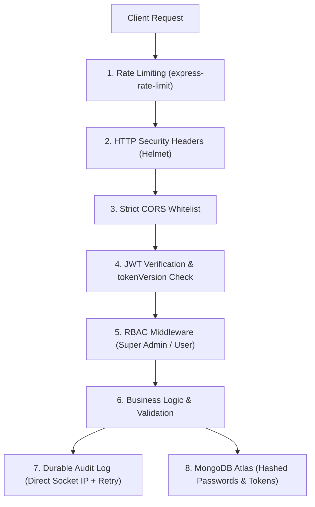

# Talkism ERP — Backend API (`ERP_BACKEND`)

[](https://nodejs.org/)
[](https://expressjs.com/)
[](https://mongoosejs.com/)
[](#)
[](#)

Internal Enterprise Resource Planning (ERP) & User Management REST API for **Talkism Private Limited**, Ernakulam, Kochi, Kerala (CIN: `U62013KL2025PTC091645`).

---

## 🏛️ System Overview

The Talkism ERP Backend is an enterprise-grade RESTful API built on the MERN architecture. It provides centralized administrative governance, invitation-based employee provisioning, granular Role-Based Access Control (RBAC), activity audit logging, and automated transactional email dispatch via Gmail SMTP.

---

## 🔒 Security Hardening Architecture

The backend implements 10 foundational security layers to comply with enterprise standards:



### Detailed Security Controls:

1. **No Public Self-Registration**:
   - The `/api/auth/register` endpoint is intentionally disabled (returns HTTP 404). Accounts can only be provisioned through Super Admin invitation.
2. **Cryptographic Email-Ownership Binding**:
   - Invitation links require verification of the invited email address (`POST /api/auth/accept-invitation`).
   - If an unauthorized recipient attempts to claim an invitation using an uninvited email, the backend rejects the request with **HTTP 403 Forbidden** and logs a `SECURITY_ALERT_EMAIL_MISMATCH` audit event.
3. **Atomic Single-Use Token Invalidation**:
   - Upon first successful account activation, the invitation token is atomically deleted from MongoDB (`$unset: { invitationToken: 1, invitationExpiresAt: 1 }`). Replay attacks are rejected with **HTTP 400 Bad Request**.
4. **Server-Side Session Revocation (`tokenVersion`)**:
   - Implements OWASP-aligned session invalidation. Every user model and JWT carries an integer `tokenVersion`.
   - The version increments upon:
     - User Logout (`POST /api/auth/logout`)
     - Password Change (`POST /api/users/change-password`)
     - Password Reset (`POST /api/auth/reset-password`)
     - Role Modification (`PATCH /api/admin/users/:id`)
     - Account Blocking or Deactivation (`PATCH /api/admin/users/:id/block`, `status: INACTIVE`)
   - `requireAuth` validates `decoded.tokenVersion === user.tokenVersion` and rejects revoked sessions with **HTTP 401 Unauthorized**.
5. **No Credential Exposure in Logs or APIs**:
   - Startup routines never log plaintext passwords.
   - `forgotPassword` returns a generic confirmation message only; reset tokens are delivered exclusively via email.
   - Raw invitation URLs and bearer tokens are stripped from application stdout and telemetry.
6. **Robust Password Security**:
   - Passwords hashed using `bcryptjs` with 10 salt rounds.
   - Enforced minimum length of 8 characters.
7. **Secure Audit Attribution**:
   - Client-supplied `X-Forwarded-For` headers are rejected unless `TRUST_PROXY=true` is explicitly enabled. The direct socket address (`req.socket.remoteAddress`) is used by default to prevent IP spoofing.
   - Audit write operations include a 3-attempt linear backoff retry with structured stderr fallback.
8. **Last Super Admin Safeguard**:
   - The backend prevents the last active Super Admin from being demoted, blocked, or deactivated.
9. **Rate Limiting**:
   - Brute-force protection on authentication routes (10 attempts per 15-minute window) and password reset endpoints (5 attempts per hour).
10. **Data Sanitization**:
    - Request validation using `validator.js` and Mongoose schema constraints.

---

## 📡 REST API Reference

### 1. Authentication Endpoints (`/api/auth`)

| Method | Endpoint | Access | Description |
|---|---|---|---|
| `POST` | `/api/auth/login` | Public (Rate Limited) | Authenticate active staff using email & password. |
| `POST` | `/api/auth/accept-invitation` | Public (Rate Limited) | Activate account with email confirmation & establish password. |
| `POST` | `/api/auth/verify-email` | Public | Verify invitation token validity (returns masked identity). |
| `POST` | `/api/auth/forgot-password` | Public (Rate Limited) | Dispatch password reset email. |
| `POST` | `/api/auth/reset-password` | Public (Rate Limited) | Establish new password using verified reset token. |
| `GET` | `/api/auth/me` | Authenticated | Retrieve current user profile and session identity. |
| `POST` | `/api/auth/logout` | Authenticated | Invalidate JWT session server-side (`tokenVersion++`). |

### 2. Super Admin User Management (`/api/admin`)

*All `/api/admin/*` endpoints strictly require valid JWT and `SUPER_ADMIN` role.*

| Method | Endpoint | Description |
|---|---|---|
| `POST` | `/api/admin/users` | Provision new employee, generate crypto token, and dispatch email. |
| `GET` | `/api/admin/users` | List staff directory with pagination, status filters, and search. |
| `GET` | `/api/admin/users/stats` | Executive KPI counts (total, active, invited, inactive, blocked). |
| `GET` | `/api/admin/users/:id` | Retrieve detailed employee record with audit metadata. |
| `PATCH` | `/api/admin/users/:id` | Update profile information, department, or role. |
| `PATCH` | `/api/admin/users/:id/status` | Activate or deactivate employee account (`ACTIVE` / `INACTIVE`). |
| `PATCH` | `/api/admin/users/:id/block` | Block employee account and sever all active sessions. |
| `PATCH` | `/api/admin/users/:id/unblock` | Unblock employee account and restore login access. |
| `POST` | `/api/admin/users/:id/resend-invitation` | Issue fresh invitation token and dispatch new onboarding email. |
| `GET` | `/api/admin/audit-logs` | Query governance audit logs with action filters and pagination. |

### 3. Employee Self-Service (`/api/users`)

| Method | Endpoint | Access | Description |
|---|---|---|---|
| `GET` | `/api/users/me` | Authenticated | Retrieve own employee profile. |
| `PATCH` | `/api/users/me` | Authenticated | Update permitted self fields (name, phone, bio). |
| `POST` | `/api/users/change-password` | Authenticated | Change password & revoke all other concurrent sessions. |

---

## 📁 Project Structure

```text
server/
├── src/
│   ├── config/            # Database connection & client configs
│   │   └── db.js               # MongoDB connection with retry handling
│   ├── controllers/       # Route controllers & business logic
│   │   ├── adminController.js  # Staff CRUD, block/unblock, stats
│   │   ├── auditController.js  # Audit log pagination & querying
│   │   ├── authController.js   # Login, activation, reset, session revocation
│   │   └── userController.js   # Self profile & password change
│   ├── middleware/        # Express middleware
│   │   ├── auth.js             # JWT verification & tokenVersion session check
│   │   ├── errorHandler.js     # Centralized error formatter
│   │   ├── rateLimiter.js      # Endpoint-specific rate limiters
│   │   └── rbac.js             # Super Admin role authorization gate
│   ├── models/            # Mongoose schemas
│   │   ├── AuditLog.js         # Security audit logging schema
│   │   └── User.js             # User model with crypto tokens & tokenVersion
│   ├── routes/            # Route declarations
│   │   ├── adminRoutes.js      # Protected Super Admin endpoints
│   │   ├── authRoutes.js       # Authentication & password endpoints
│   │   └── userRoutes.js       # Employee self-service endpoints
│   ├── services/          # Core background services
│   │   ├── auditService.js     # Durable activity logging with retry logic
│   │   ├── emailService.js     # Nodemailer Gmail SMTP integration
│   │   └── tokenService.js     # JWT signing, verification & sha256 hashing
│   ├── utils/             # Setup and seeding utilities
│   │   └── seedSuperAdmin.js   # Initial Super Admin provisioning (hardened)
│   └── server.js          # Express app entry point
├── .env.example           # Environment template (zero secrets tracked)
├── .gitignore             # Comprehensive Git exclusion rules
├── package.json           # Dependencies and test scripts
└── test-api.js            # Automated verification suite (29 assertions)
```

---

## 🚀 Getting Started

### Prerequisites
- Node.js `v18.0.0` or higher
- MongoDB instance (Local MongoDB or MongoDB Atlas)

### Installation

```bash
# Clone the repository
git clone https://github.com/Nashid-k/ERP_BACKEND.git
cd ERP_BACKEND

# Install dependencies
npm install
```

### Environment Configuration

Create a `.env` file from the provided template:

```bash
cp .env.example .env
```

Configure your environment parameters:

```env
PORT=5000
MONGODB_URI=mongodb://127.0.0.1:27017/erp_database
JWT_SECRET=your_jwt_secret_key_here
JWT_EXPIRES_IN=7d
CLIENT_URL=http://localhost:5173
NODE_ENV=development

# Super Admin Provisioning (Used on initial system seed only)
SUPER_ADMIN_NAME=Talkism Administrator
SUPER_ADMIN_EMAIL=superadmin@talkism.com
SUPER_ADMIN_PASSWORD=your_super_admin_strong_password

# SMTP Configuration (Gmail or Enterprise SMTP)
SMTP_HOST=smtp.gmail.com
SMTP_PORT=465
SMTP_USER=your_email@gmail.com
SMTP_PASS=your_app_password
SMTP_FROM=Talkism Private Limited <your_email@gmail.com>

# Reverse Proxy Trust (Set to true if behind Render / Nginx / Cloudflare)
TRUST_PROXY=false
```

### Run Server

```bash
# Development mode with nodemon
npm run dev

# Production mode
npm start
```

---

## 🧪 Automated Testing

The backend includes a comprehensive, automated verification suite in `test-api.js` testing 29 core business and security assertions:

```bash
npm test
```

### Test Assertions Covered:
- Health check availability
- Public registration block (HTTP 404)
- Super Admin authentication & token generation
- Employee creation & crypto invitation token dispatch
- Block unactivated user login (HTTP 403)
- Reject invitation acceptance with missing email (HTTP 400)
- Reject invitation acceptance with mismatched/forwarded email (HTTP 403)
- Successful invitation acceptance with matching bound email (HTTP 200)
- Immediate single-use token invalidation / replay attack rejection (HTTP 400)
- Regular user RBAC restriction from admin APIs (HTTP 403)
- Employee self-profile update & role tampering prevention (HTTP 403)
- Admin user deactivation & inactive session rejection
- Admin block & unblock lifecycle flows
- Forgot password secret suppression (zero tokens in API payload)
- Server-side JWT session revocation upon logout (HTTP 401)
- Re-login fresh session issuance

---

## 📄 License & Corporate Notice

Copyright © 2026 **Talkism Private Limited** (Talkisam Pvt Ltd), Ernakulam, Kochi, Kerala - 682037.  
All rights reserved. Internal enterprise software — unauthorized copying or distribution is strictly prohibited.
